# EnergySense Copilot (Team APEX)
> **AI-Powered Campus Energy Intelligence, Anomaly Detection & Forecasting Platform**

[](https://fastapi.tiangolo.com)
[](https://streamlit.io)
[](https://github.com/tobymao/sqlglot)
[](https://www.python.org)
[]()

---

## Executive Summary

**EnergySense Copilot** is an enterprise-grade energy analytics assistant designed for campus facility managers, energy analysts, and sustainability directors. The system monitors **15 campus facilities** (Site "Hog") comprising **263,160 hourly interval electricity records** (2016–2017), flags **41,499 operational anomalies**, computes **12-to-168-hour persistence forecasts with 90% calibrated empirical uncertainty intervals**, and synthesizes actionable conservation recommendations.

The architecture strictly separates **probabilistic Generative AI** (natural language interpretation, SQL plan drafting) from **deterministic code guardrails** (AST security verification, deterministic intent routing, statistical anomaly models, mathematical sanity checking, and read-only query execution) to prevent hallucinations, protect database integrity, and guarantee numerical accuracy.

---

## 1. System Architecture & Solution Design

The following architecture diagram illustrates the end-to-end request lifecycle and highlights which system components rely on **Generative AI** versus **Deterministic Code**.

### 1.1 Architecture Diagram: Gen AI vs. Deterministic Code

```mermaid
flowchart TD
    %% Styling Definitions
    classDef genai fill:#7c3aed,stroke:#5b21b6,stroke-width:2px,color:#ffffff,font-weight:bold;
    classDef deterministic fill:#0284c7,stroke:#0369a1,stroke-width:2px,color:#ffffff,font-weight:bold;
    classDef storage fill:#059669,stroke:#047857,stroke-width:2px,color:#ffffff,font-weight:bold;
    classDef client fill:#d97706,stroke:#b45309,stroke-width:2px,color:#ffffff,font-weight:bold;

    subgraph CLIENT_LAYER ["1. Presentation Layer (Streamlit & Plotly)"]
        UI["Streamlit Web Dashboard<br/>frontend/EnergySense/app.py"]:::client
        PlotlyCharts["Interactive Plotly Charts & Confidence Ribbons<br/>frontend/EnergySense/charts.py"]:::deterministic
        APIClient["Resilient API Client with In-Process Fallback<br/>frontend/EnergySense/api_client.py"]:::deterministic
    end

    subgraph API_LAYER ["2. API & Gateway Layer"]
        FastAPIRouter["FastAPI Endpoints (POST /api/v1/chat/query)<br/>backend/app/api/routes.py"]:::deterministic
        Orchestrator["Agent Orchestrator<br/>backend/app/agent/orchestrator.py"]:::deterministic
    end

    subgraph ROUTING_LAYER ["3. Intent Routing & Ambiguity Interceptor"]
        IntentRouter["Deterministic Intent Router<br/>backend/app/agent/intent_router.py<br/>(Regex / Fast-Path Keyword Engine)"]:::deterministic
        ClarificationHandler["Clarification Generator<br/>(Structured Clarification Prompt)"]:::deterministic
    end

    subgraph GENAI_LAYER ["4. Generative AI Layer (Probabilistic)"]
        LLMClient["BaseLLMClient (OpenAI GPT-4o-mini / Dual-Mode Mock)<br/>backend/app/agent/llm_client.py"]:::genai
        SQLGen["Natural Language-to-SQL Generator<br/>backend/app/agent/sql_generator.py"]:::genai
        ChartSpecGen["Chart Specification Inferrer<br/>(JSON Chart Metadata Generation)"]:::genai
        ConversationalGen["Conversational Small-Talk Synthesizer"]:::genai
    end

    subgraph AST_SECURITY_LAYER ["5. Deterministic Security & Validation (Zero-Trust)"]
        SQLGlotValidator["SQLGlot AST Security Validator<br/>backend/app/agent/sql_validator.py<br/>- Single SELECT Enforced<br/>- Mutation Blocker (DROP/UPDATE/DELETE)<br/>- Schema Whitelist Verification<br/>- Forbidden Function Blocker (pg_sleep, load_ext)<br/>- Row Limit Injection & Capping (100 / max 500)"]:::deterministic
    end

    subgraph DOMAIN_SERVICES ["6. Deterministic Analytics & Verification Services"]
        AnomalyEngine["Person 2: Anomaly Service<br/>backend/app/services/anomaly_service.py<br/>(Z-Score Spikes, Flatlines, Missing Meters)"]:::deterministic
        ForecastEngine["Person 3: Forecasting Service<br/>backend/app/services/forecast_service.py<br/>(168h/24h Seasonal Persistence Model)"]:::deterministic
        UncertaintyCalc["Calibrated Uncertainty Calculator<br/>(90th Percentile Empirical Error Bounds)"]:::deterministic
        SanityVerifier["Numerical Sanity Verifier (validate_results)<br/>(Deterministic ±0.1% Deviation Check)"]:::deterministic
        RecommendationEngine["Rule-Based Action Recommender<br/>(Tailored Occupancy & HVAC Setpoint Rules)"]:::deterministic
    end

    subgraph DATA_EXECUTION_LAYER ["7. Safe Execution & Persistence Layer"]
        QueryExec["Safe Query Executor<br/>backend/app/database/query_executor.py<br/>(Read-Only Session, Timeout Enforcer, Credential Stripping)"]:::deterministic
        Database[("SQLite / PostgreSQL Canonical Store<br/>263,160 Hourly Readings<br/>41,499 Anomaly Records")]:::storage
    end

    %% Flow Connections
    UI --> APIClient
    APIClient --> FastAPIRouter
    FastAPIRouter --> Orchestrator
    Orchestrator --> IntentRouter

    %% Routing Decisions
    IntentRouter -- "Ambiguous Query ('wasting electricity')" --> ClarificationHandler
    IntentRouter -- "Greeting / Small-Talk" --> ConversationalGen
    IntentRouter -- "NL Energy Query" --> SQLGen
    IntentRouter -- "Anomaly Question" --> AnomalyEngine
    IntentRouter -- "Forecast Question" --> ForecastEngine
    IntentRouter -- "Recommendation Question" --> RecommendationEngine
    IntentRouter -- "Verification Claim" --> SanityVerifier

    %% SQL Generation & Validation
    SQLGen --> LLMClient
    LLMClient --> SQLGen
    SQLGen --> SQLGlotValidator

    %% Validation Outcomes
    SQLGlotValidator -- "AST Validated & Sanitized" --> QueryExec
    SQLGlotValidator -- "AST Parse/Mutation Error" --> Orchestrator

    %% Execution
    QueryExec --> Database
    Database --> QueryExec
    QueryExec --> Orchestrator

    %% External Domain Service Flow
    AnomalyEngine --> Database
    ForecastEngine --> Database
    ForecastEngine --> UncertaintyCalc
    SanityVerifier --> Orchestrator
    RecommendationEngine --> Orchestrator

    %% Response Path
    ClarificationHandler --> Orchestrator
    ConversationalGen --> Orchestrator
    Orchestrator --> ChartSpecGen
    Orchestrator --> FastAPIRouter
    FastAPIRouter --> APIClient
    APIClient --> PlotlyCharts
    PlotlyCharts --> UI
```



---

### 1.2 Gen AI vs. Deterministic Architecture Map

| Subsystem | Component | Implementation File | Type | Why This Choice Was Made |
|---|---|---|---|---|
| **Natural Language Understanding** | Intent Routing | [intent_router.py](file:///c:/Users/mohit/Downloads/HCL-Hackathon-Team-APEX/backend/app/agent/intent_router.py) | **Deterministic** | Regex/keyword fast-paths eliminate LLM latency (0.1ms execution) and prevent prompt injection from bypassing safety filters. |
| **Ambiguity Interception** | Clarification Prompter | [intent_router.py](file:///c:/Users/mohit/Downloads/HCL-Hackathon-Team-APEX/backend/app/agent/intent_router.py) | **Deterministic** | Vague questions (e.g., *"wasting electricity"*) immediately return structured clarification choices without wasting LLM tokens or running open-ended queries. |
| **SQL Translation** | NL-to-SQL Drafting | [sql_generator.py](file:///c:/Users/mohit/Downloads/HCL-Hackathon-Team-APEX/backend/app/agent/sql_generator.py) | **Generative AI** | Handles human query variance (synonyms, ranking filters, time window phrasing) and maps natural questions to SQL statements. |
| **AST Security Layer** | SQLGlot AST Validator | [sql_validator.py](file:///c:/Users/mohit/Downloads/HCL-Hackathon-Team-APEX/backend/app/agent/sql_validator.py) | **Deterministic** | Generative models cannot be trusted with security. SQLGlot analyzes the Abstract Syntax Tree recursively to guarantee read-only SELECT execution. |
| **Query Execution** | Safe Query Executor | [query_executor.py](file:///c:/Users/mohit/Downloads/HCL-Hackathon-Team-APEX/backend/app/database/query_executor.py) | **Deterministic** | Enforces database timeouts, read-only transaction isolation, and scrubs credentials/internal paths from error strings. |
| **Data Ingestion & Hygiene** | Data Cleaning & Storage | [energy_service.py](file:///c:/Users/mohit/Downloads/HCL-Hackathon-Team-APEX/backend/app/services/energy_service.py) | **Deterministic** | Exact timestamp standardization, missing interval detection, and schema verification for 263,160 readings across 15 buildings. |
| **Anomaly Detection** | Spikes, Flatlines & Dropouts | [anomaly_service.py](file:///c:/Users/mohit/Downloads/HCL-Hackathon-Team-APEX/backend/app/services/anomaly_service.py) | **Deterministic** | Statistical Z-score deviation, nocturnal baselines, and flatline frozen meter algorithms guarantee zero false hallucinated anomalies. |
| **Load Forecasting** | 168h / 24h Persistence Model | [forecast_service.py](file:///c:/Users/mohit/Downloads/HCL-Hackathon-Team-APEX/backend/app/services/forecast_service.py) | **Deterministic** | Weekly periodicity (168-hour lag) and diurnal cycle (24-hour lag) physically reflect building schedules without black-box drift. |
| **Uncertainty Bounds** | Calibrated Error Margins | [forecast_service.py](file:///c:/Users/mohit/Downloads/HCL-Hackathon-Team-APEX/backend/app/services/forecast_service.py) | **Deterministic** | 90th percentile absolute empirical error computed by hour-of-day ensures monotonic confidence bands (`lower <= forecast <= upper`). |
| **Numerical Sanity** | Claim Verifier | [forecast_service.py](file:///c:/Users/mohit/Downloads/HCL-Hackathon-Team-APEX/backend/app/services/forecast_service.py) | **Deterministic** | Verifies quantitative percentage assertions ($\pm 0.1\%$ tolerance) to prevent LLM mathematical hallucinations. |
| **Operational Guidance** | Action Recommender | [forecast_service.py](file:///c:/Users/mohit/Downloads/HCL-Hackathon-Team-APEX/backend/app/services/forecast_service.py) | **Deterministic** | Domain heuristics map building types (education, laboratory, residential, parking) to verified HVAC, lighting, and ventilation setback rules. |
| **Visualization** | Chart Spec & Plotly Rendering | [charts.py](file:///c:/Users/mohit/Downloads/HCL-Hackathon-Team-APEX/frontend/EnergySense/charts.py) | **Deterministic** | Renders Plotly charts and confidence interval ribbons based on explicit numerical payloads. |

---

## 2. Design Choices, Trade-offs & Risks

### Design Choice 1: Deterministic Guardrails First (Hybrid Intent Routing)
* **Rationale:** In facility operations, routing critical operational inquiries solely through an autonomous LLM agent introduces nondeterminism, latency, and susceptibility to jailbreaking. Our [IntentRouter](file:///c:/Users/mohit/Downloads/HCL-Hackathon-Team-APEX/backend/app/agent/intent_router.py) uses deterministic regex and keyword pattern matching to intercept greetings, ambiguous phrasing, anomaly checks, and forecast commands within microseconds.
* **Trade-off:** Static pattern maintenance is required when adding new domain intents, rather than relying on an open-ended autonomous agent prompt.
* **Risk & Mitigation:** If a question uses unusual phrasing, it falls through to the NL-to-SQL module where the LLM parses the user's intent. If unparseable, a structured clarification prompt is triggered.

### Design Choice 2: SQLGlot AST Validation vs. Regex Blacklists
* **Rationale:** Regex blacklists (e.g., checking for `"DROP"` or `";"`) fail against SQL injection techniques such as comments (`--`), nested CTEs (`WITH x AS (DELETE ...)`), or string encodings. Our [SQLValidator](file:///c:/Users/mohit/Downloads/HCL-Hackathon-Team-APEX/backend/app/agent/sql_validator.py) uses `sqlglot` to parse the Abstract Syntax Tree into structured expressions.
* **AST Security Guarantees:**
  1. **Strict Read-Only:** Only `exp.Select` and `exp.Union` root statements are permitted.
  2. **Recursive Mutation Scanning:** Any `Insert`, `Update`, `Delete`, `Drop`, `Alter`, `Create`, or `Command` expression—even nested inside CTEs or subqueries—immediately aborts execution.
  3. **Strict Whitelist:** Tables and columns are checked against authorized schemas (`buildings`, `energy_readings`, `anomaly_events`).
  4. **Forbidden Functions:** Disallows system execution functions like `pg_sleep`, `load_extension`, `pg_read_file`, and `system`.
  5. **Row Limit Enforcement:** Automatically injects `LIMIT 100` if omitted, and caps any requested limit at `500`.
* **Trade-off:** Adds 1–3ms of AST parsing overhead before execution.
* **Risk & Mitigation:** False rejections of complex analytical queries. Mitigated by allowing table aliases and Common Table Expressions (CTEs) while inspecting their contents recursively.

### Design Choice 3: Dual-Mode LLM Client (OpenAI + Deterministic Mock)
* **Rationale:** Running automated continuous integration (CI) tests or offline demos should not depend on external paid API credentials, internet availability, or rate limits. The [BaseLLMClient](file:///c:/Users/mohit/Downloads/HCL-Hackathon-Team-APEX/backend/app/agent/llm_client.py) switches to `MockRuleBasedLLMClient` when `OPENAI_API_KEY` is absent or during automated test runs.
* **Trade-off:** The mock client uses deterministic pattern-matching templates for predefined question structures, while the live OpenAI client (`gpt-4o-mini`) handles arbitrary phrasing.
* **Risk & Mitigation:** In production, network timeouts or OpenAI API outages are caught and safely returned as structured error messages without crashing the server or leaking system paths.

### Design Choice 4: Seasonal Persistence Forecasting with Calibrated Empirical Bounds
* **Rationale:** Campus electricity demand is driven by physical schedules: academic semesters, operating hours, and weekly calendar cycles. Deep learning models (e.g. LSTMs or Transformers) require extensive fine-tuning, suffer from cold-start issues, and can act as black boxes. We implemented a **168-hour seasonal persistence model** (same hour previous week) with a 24-hour daily fallback, augmented with **empirical 90th-percentile absolute error margins** by hour-of-day.
* **Trade-off:** Cannot forecast macro regime changes that have never occurred in history (e.g., sudden unscheduled campus closures).
* **Risk & Mitigation:** Extreme weather shocks outside historical ranges. Calibrated uncertainty bands expand during volatile hours to visually communicate uncertainty to facility managers.

### Design Choice 5: Deterministic Numerical Sanity Verification (`validate_results`)
* **Rationale:** Generative LLMs frequently make arithmetic errors when summarizing data (e.g., claiming a building increased consumption by 40% when the raw data shows 12%).
* **Guarantees:** The [validate_results](file:///c:/Users/mohit/Downloads/HCL-Hackathon-Team-APEX/backend/app/services/forecast_service.py) service recomputes mathematical percentage deviations $\frac{actual - baseline}{baseline} \times 100$ deterministically with a $\pm 0.1\%$ tolerance before presenting answers.

### Design Choice 6: Resilient Dual-Mode Frontend Architecture
* **Rationale:** Facility operators need constant dashboard availability. In [api_client.py](file:///c:/Users/mohit/Downloads/HCL-Hackathon-Team-APEX/frontend/EnergySense/api_client.py), the Streamlit UI connects to FastAPI via REST (`POST /api/v1/chat/query`). If the FastAPI daemon is offline or starting up, the client automatically falls back to an **in-process direct engine execution mode**, ensuring zero dashboard downtime.

---

## 3. Team Responsibilities & Integration Contracts

The solution is split cleanly across 4 engineering domains:

```
┌────────────────────────────────────────────────────────────────────────┐
│                        TEAM APEX DIVISION                              │
├─────────────────┬─────────────────┬──────────────────┬─────────────────┤
│    Person 1     │    Person 2     │     Person 3     │    Person 4     │
│   AI & Safety   │Data Engineering │  Forecasting &   │ Frontend & UI   │
│  Orchestration  │   & Anomalies   │ Recommendations  │ Visualizations  │
├─────────────────┼─────────────────┼──────────────────┼─────────────────┤
│ • Orchestrator  │ • Canonical DB  │ • 168h Forecast  │ • Streamlit App │
│ • NL-to-SQL Gen │ • 263k Readings │ • 90% Bounds     │ • Plotly Charts │
│ • SQLGlot AST   │ • Anomaly Engine│ • Sanity Checks  │ • Dual Client   │
│ • FastAPI Router│ • Data Quality  │ • Recommendations│ • KPI Dashboard │
└─────────────────┴─────────────────┴──────────────────┴─────────────────┘
```

### Contract Interfaces

#### 1. Person 2 Interface ([energy_service.py](file:///c:/Users/mohit/Downloads/HCL-Hackathon-Team-APEX/backend/app/services/energy_service.py) & [anomaly_service.py](file:///c:/Users/mohit/Downloads/HCL-Hackathon-Team-APEX/backend/app/services/anomaly_service.py))
```python
def get_energy_data(building_ids: list[str] | None, start_time: str, end_time: str) -> dict: ...
def detect_anomalies(building_ids: list[str] | None, start_time: str, end_time: str) -> dict: ...
def detect_flatlines(building_ids: list[str] | None, consecutive_threshold: int = 4) -> dict: ...
```

#### 2. Person 3 Interface ([forecast_service.py](file:///c:/Users/mohit/Downloads/HCL-Hackathon-Team-APEX/backend/app/services/forecast_service.py))
```python
def forecast_energy(building_ids: list[str] | None, horizon_hours: int = 24, method: str = "seasonal_persistence") -> dict: ...
def validate_results(results: dict, claims: list[str] | None = None) -> dict: ...
def generate_recommendations(building_ids: list[str] | None = None) -> dict: ...
```

#### 3. Person 4 API Contract (`POST /api/v1/chat/query`)
```json
{
  "status": "success",
  "intent": "sql_query",
  "answer": "The building with the highest electricity consumption is Hog_education_Donnie with 1,248,390.20 kWh.",
  "data": [
    {
      "building_id": "Hog_education_Donnie",
      "name": "Donnie Education Hall",
      "total_consumption_kwh": 1248390.2
    }
  ],
  "chart": {
    "type": "bar",
    "x": "name",
    "y": "total_consumption_kwh",
    "x_label": "Building",
    "y_label": "Total Energy (kWh)",
    "title": "Top Electricity Consumer"
  },
  "sql_query": "SELECT b.building_id, b.name, ROUND(SUM(r.consumption_kwh), 2) AS total_consumption_kwh FROM energy_readings AS r JOIN buildings AS b ON r.building_id = b.building_id GROUP BY b.building_id, b.name ORDER BY total_consumption_kwh DESC LIMIT 1",
  "warnings": [],
  "needs_clarification": false,
  "clarification_question": null,
  "execution_time_ms": 14.2
}
```

---

## 4. Step-by-Step Setup & Installation

### Prerequisites
- **Python 3.10+** (Tested on Python 3.10, 3.11, 3.12)
- **Git**
- Optional: OpenAI API Key (System operates fully offline with mock engine if omitted)

### Step 1: Clone Repository & Create Virtual Environment
```bash
# Clone the repository
git clone https://github.com/Mkyadav11/HCL-Hackathon-Team-APEX.git
cd HCL-Hackathon-Team-APEX

# Create a virtual environment
python -m venv .venv

# Activate virtual environment
# Windows (PowerShell):
.venv\Scripts\Activate.ps1
# Linux / macOS:
source .venv/bin/activate
```

### Step 2: Install Dependencies
```bash
pip install -r requirements.txt
```

### Step 3: Environment Configuration
Copy `.env.example` to `.env`:
```bash
cp .env.example .env
```
Key configuration parameters in `.env`:
```ini
# Environment
ENV=development

# Optional OpenAI configuration (leave blank for offline mock mode)
OPENAI_API_KEY=your_openai_api_key_here
OPENAI_MODEL=gpt-4o-mini

# Database Configuration (SQLite default; PostgreSQL supported)
DB_TYPE=sqlite
SQLITE_PATH=backend/database/energy_data.db

# Query Safety Limits
QUERY_TIMEOUT_SECONDS=5.0
DEFAULT_ROW_LIMIT=100
MAX_ROW_LIMIT=500
```

### Step 4: Initialize and Seed Canonical Database
The database seeds automatically on startup if missing. To manually seed the canonical 263,160 readings:
```bash
python -m backend.app.database.seed_data
```

### Step 5: Start the FastAPI Backend Server
```bash
python -m uvicorn backend.app.main:app --host 0.0.0.0 --port 8000 --reload
```
* **Interactive OpenAPI Docs:** [http://localhost:8000/docs](http://localhost:8000/docs)
* **API Health Check:** [http://localhost:8000/health](http://localhost:8000/health)

### Step 6: Start the Streamlit Frontend UI
In a separate terminal (with the virtual environment activated):
```bash
python -m streamlit run frontend/EnergySense/app.py
```
* **Frontend Web Dashboard:** [http://localhost:8501](http://localhost:8501)

### Step 7: Run the Automated Test Suite (All 87 Tests)
```bash
python -m pytest backend/tests -v
```

---

## 5. Supported Query Capabilities & Examples

| Intent | Example User Prompt | Engine / Module Executed | Response Output |
|---|---|---|---|
| **Top Ranking** | *"Which building consumed the most electricity last week?"* | LLM + SQLGlot AST + Safe Executor | Bar chart + top building total kWh |
| **Comparative Analysis** | *"Compare electricity consumption across all buildings this month."* | LLM + SQLGlot AST + Safe Executor | Multi-building comparative bar chart |
| **Time Series Trend** | *"Show hourly consumption trend for Building 01."* | LLM + SQLGlot AST + Safe Executor | Plotly hourly time-series chart |
| **Anomaly Detection** | *"Which meters have stopped reporting?"* | Person 2 Anomaly Detection Engine | Flagged meter dropouts & zero-reading timestamps |
| **Nocturnal Spikes** | *"Which buildings have unusually high electricity consumption at night?"* | Person 2 Nocturnal Analysis | Detected spike events during off-hours |
| **Load Forecasting** | *"Forecast electricity consumption for Donnie Hall over next 24 hours"* | Person 3 168h Persistence Model | 24-point forecast with 90% confidence ribbon |
| **Multi-Day Horizon** | *"Show me expected consumption for the next seven days"* | Person 3 168h Persistence Model | 168-hour demand projection with bounds |
| **Efficiency Actions** | *"What actions could help reduce energy wastage?"* | Person 3 Savings Recommender | Estimated weekend kWh savings + HVAC setback rules |
| **Ambiguity Interception** | *"Which building is wasting the most electricity?"* | Deterministic Clarification Route | Structured prompt requesting specific analysis criteria |
| **Small-Talk / Greeting** | *"Hello, how are you?"* | Conversational Handler (No Tools) | Direct greeting response without database access |
| **Out-of-Scope Protection** | *"What is the capital of France?"* | Out-of-Domain Route (No Tools) | Clarifies scope limitation to campus energy analytics |

---

## 6. Limits of the Solution & Technical Constraints

1. **Domain Data Scope:**
   - The system is built for **electricity consumption (kWh)** across 15 campus facilities.
   - It does not ingest water, natural gas, steam, chilled water thermal tonnage, or ambient weather variables (temperature, solar irradiance, relative humidity).

2. **Forecast Persistence Assumptions:**
   - The forecasting model relies on **168-hour seasonal persistence** and **24-hour diurnal patterns**.
   - It assumes future building operating schedules reflect past behavior. Unscheduled campus closures, holidays not in the historical dataset, or extreme weather events cannot be anticipated without external weather forecasting feeds.

3. **Single Read-Only Statement Constraint:**
   - The AST security validator deliberately permits **only a single `SELECT` statement**.
   - Multi-statement SQL scripts, procedural transactions (`BEGIN/COMMIT`), and write operations (`INSERT/UPDATE/DELETE/ALTER/DROP`) are rejected by design.

4. **Query Complexity & Execution Caps:**
   - Query execution has a strict default timeout of **5.0 seconds** and row limits capped at **500 rows** to protect memory.
   - Highly complex statistical regressions or recursive graph traversals cannot be resolved in single SQL statements and are instead routed to specialized Python analytical services.

5. **LLM Nondeterminism:**
   - When connected to external LLMs, phrasing in the answer text may vary between calls.
   - However, the underlying numbers, chart data, and calculations are strictly deterministic and verified against database records.

6. **SQLite Concurrency in Local Development:**
   - The default local development setup uses SQLite, which uses database-level locking during write operations.
   - While read queries are thread-safe, multi-user production deployments should configure PostgreSQL via the `.env` configuration.

---

## 7. Verification & Testing Evidence

The test suite validates safety, data integrity, forecasting monotonicity, and UI integration:

```
============================= test session starts =============================
platform win32 -- Python 3.11.x, pytest-8.3.x, pluggy-1.5.x
collected 87 items

backend/tests/test_api.py .........................                      [ 10%]
backend/tests/test_llm_question_answering.py ...........                 [ 21%]
backend/tests/test_orchestrator.py .........                             [ 31%]
backend/tests/test_person2_data_engineering.py ............              [ 44%]
backend/tests/test_person3_forecasting.py ...........                    [ 57%]
backend/tests/test_person4_frontend.py .............                     [ 73%]
backend/tests/test_query_executor.py .....                               [ 79%]
backend/tests/test_sql_generator.py ......                               [ 86%]
backend/tests/test_sql_validator.py ............                         [100%]

============================== 87 passed in 6.58s ==============================
```

### Key Verified Invariants
- **Security:** 100% rejection rate for SQL injections, table mutations, unauthorized column queries, and forbidden functions (`pg_sleep`, `system`).
- **Forecasting Monotonicity:** Verifies that $\text{lower\_bound\_kwh} \le \text{forecast\_kwh} \le \text{upper\_bound\_kwh}$ across all prediction horizons.
- **Numerical Sanity:** Guarantees deviation calculations match ground-truth formulas within $\pm 0.1\%$.
- **Resilience:** Automatic fallback from FastAPI REST client to direct in-process engine execution when the API server is unavailable.

---

## 8. Directory Structure

```
HCL-Hackathon-Team-APEX/
├── README.md                                  # System Architecture, Setup & Technical Limits
├── AGENTS.md                                  # Team Roles & System Conventions
├── requirements.txt                           # Unified Python Dependencies
├── .env.example                               # Environment Configuration Template
├── backend/
│   ├── app/
│   │   ├── main.py                            # FastAPI Application Entrypoint
│   │   ├── config.py                          # Settings & Environment Variables
│   │   ├── agent/
│   │   │   ├── orchestrator.py                # Core Agent Orchestrator
│   │   │   ├── intent_router.py               # Deterministic Fast-Path & Ambiguity Router
│   │   │   ├── sql_generator.py               # NL-to-SQL Translation Layer
│   │   │   ├── sql_validator.py               # SQLGlot AST Security Validation Engine
│   │   │   └── llm_client.py                  # Dual-Mode LLM Client (OpenAI + Mock)
│   │   ├── api/
│   │   │   └── routes.py                      # REST Endpoints (POST /api/v1/chat/query)
│   │   ├── database/
│   │   │   ├── connection.py                  # Database Connection Manager (SQLite/PostgreSQL)
│   │   │   ├── query_executor.py              # Safe Read-Only Query Executor
│   │   │   ├── schema_context.py              # Canonical Schema Context & Whitelists
│   │   │   └── seed_data.py                   # Automatic Database Seeder
│   │   ├── schemas/
│   │   │   └── responses.py                   # Pydantic Response & Chart Data Models
│   │   └── services/
│   │       ├── energy_service.py              # Person 2: Data Retrieval & Clean Records
│   │       ├── anomaly_service.py             # Person 2: Anomaly Detection Engine
│   │       ├── anomaly_engine.py              # Person 2: Anomaly Summary Engine
│   │       └── forecast_service.py            # Person 3: Forecasting, Uncertainty & Actions
│   ├── data/                                  # Canonical CSV Datasets & Anomaly Summaries
│   ├── database/                              # SQLite Local Database Store
│   └── tests/                                 # 87 Automated Tests (Unit, E2E, Security)
└── frontend/
    └── EnergySense/
        ├── app.py                             # Streamlit Campus Dashboard (5 Tabs)
        ├── api_client.py                      # Resilient API Client with Direct Fallback
        └── charts.py                          # Plotly Visualizations & Uncertainty Ribbons
```

---

## 9. Contributors — Team APEX
- **Person 1:** AI Orchestration, NL-to-SQL Generation, SQLGlot AST Security Validation & API Layer
- **Person 2:** Data Cleaning, Canonical Database Ingestion, Flatline & Spike Anomaly Detection
- **Person 3:** Time-Series Forecasting, Calibrated Uncertainty Bounds & Savings Recommendations
- **Person 4:** Frontend UI (Streamlit), KPI Visualizations & Plotly Interactive Charts
